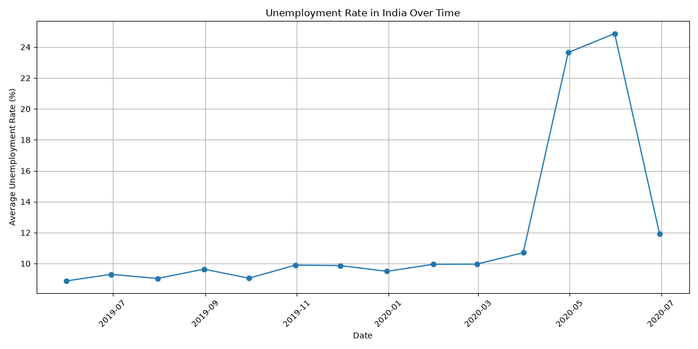
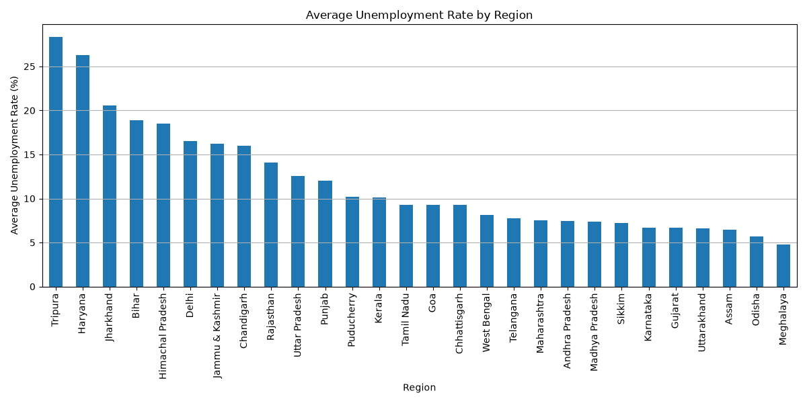
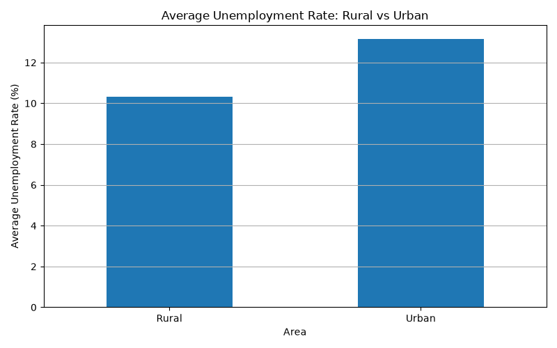

# Unemployment Analysis with Python

## Project Overview

This project analyzes unemployment data in India using Python. The goal is to explore unemployment trends over time, compare unemployment rates across regions, and examine the difference between rural and urban areas.

This project was completed as part of the CodeAlpha Data Science Internship.

## Objectives

- Clean and prepare the unemployment dataset.
- Explore the dataset using Pandas.
- Analyze unemployment trends over time.
- Compare unemployment rates across regions.
- Compare rural and urban unemployment rates.
- Visualize findings using Matplotlib and Seaborn.

## Technologies Used

- Python
- Pandas
- Matplotlib
- Seaborn

## Dataset

The dataset contains unemployment information for different regions of India, including:

- Region
- Date
- Frequency
- Estimated Unemployment Rate (%)
- Estimated Employed
- Estimated Labour Participation Rate (%)
- Area (Rural or Urban)

The original dataset contains 768 rows. After removing rows with missing values, 740 rows remained for analysis.

## Data Cleaning

The following preprocessing steps were performed:

1. Loaded the CSV file using Pandas.
2. Removed extra spaces from column names and text values.
3. Removed rows containing missing values.
4. Converted the Date column to datetime format.
5. Sorted the dataset by date.

## Visualizations

### 1. Unemployment Rate Over Time



This line chart shows how the average unemployment rate changed over the dataset's time period.

### 2. Average Unemployment Rate by Region



This bar chart compares the average unemployment rate across regions.

### 3. Rural vs Urban Unemployment Rate



This chart compares the average unemployment rate in rural and urban areas.

## Key Findings

Based on the analyzed dataset:

- Overall average unemployment rate: **11.79%**
- Region with the highest average unemployment rate: **Tripura (28.35%)**
- Region with the lowest average unemployment rate: **Meghalaya (4.80%)**
- Average rural unemployment rate: **10.32%**
- Average urban unemployment rate: **13.17%**

Urban areas had a higher average unemployment rate than rural areas in this dataset.

These findings describe the dataset and do not establish the causes of unemployment.

## How to Run

1. Install Python.
2. Install the required libraries:

   ```bash
   python -m pip install pandas matplotlib seaborn
   ```

3. Place `Unemployment in India.csv` in the same folder as the Python script.
4. Run:

   ```bash
   python unemployment_analysis.py
   ```

## Project Files

- `unemployment_analysis.py` — Python analysis script
- `Unemployment in India.csv` — Dataset
- `unemployment_trend.png` — Unemployment trend chart
- `unemployment_by_region.png` — Regional comparison chart
- `rural_vs_urban.png` — Rural and urban comparison chart
- `README.md` — Project documentation
